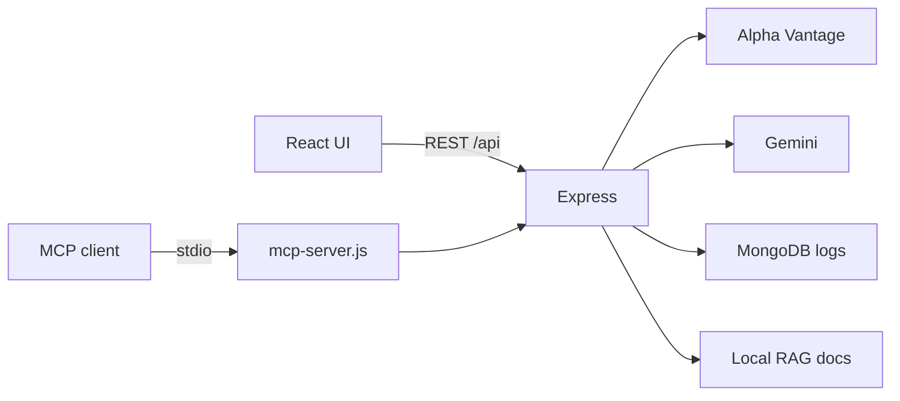

# TradeLens AI

Educational stock-research workspace. Analyze a ticker, run a historical SMA crossover backtest, then ask Gemini to explain the numbers. Includes a tool-using AI agent, a RAG knowledge assistant, and an optional MCP server.

This is a **working full-stack prototype**: React UI + Express API + MongoDB + market data + Gemini. It is **not** a broker, not live trading, and not investment advice.


---

## Features

| Area | What it does |
| --- | --- |
| Stock search | Search / pick popular Indian BSE tickers (for example `RELIANCE.BSE`) |
| Market scan | Latest close, 5-day SMA, above/below SMA signal, recent-price sparkline |
| Backtest | 5-day / 20-day SMA crossover on historical daily closes, with costs |
| AI research | Gemini report grounded only in the scan + backtest JSON |
| AI agent | Gemini function calling: `get_stock_analysis` and `run_backtest` |
| Agent activity | Last 20 tool runs stored in MongoDB |
| Knowledge RAG | Keyword retrieval over a local finance education corpus, then Gemini |
| MCP server | Same tools over stdio for Cursor / other MCP clients |

---

## Tech stack

**Frontend**

- React 19 + Vite
- `react-markdown` for Gemini answers

**Backend**

- Node.js, Express 5
- MongoDB + Mongoose (agent logs)
- Google Gemini (`@google/genai`)
- Alpha Vantage daily time series
- Zod + Model Context Protocol SDK (`mcp-server.js`)

**Strategy logic**

- SMA in `backend/utils/indicators.js`
- Backtest in `backend/utils/backtest.js` (trade on the next close after a crossover; 0.1% cost)

---

## How it works (simple)

```text
You pick a stock
        ↓
Frontend calls  GET /api/stocks/:symbol/analyze
        ↓
Backend fetches daily candles from Alpha Vantage
        ↓
Backend computes SMA signal + SMA crossover backtest
        ↓
UI shows price, sparkline, metrics, and trades
```

Optional next steps:

1. **Research** — UI posts the same scan/backtest numbers to Gemini. Gemini only explains those figures.
2. **Agent** — you ask in plain English. Gemini may call a tool. Backend runs analysis, sends results back to Gemini, saves the log in MongoDB.
3. **Knowledge** — your question is matched against local documents (drawdown, backtesting, win rate, SMAs, risk). Gemini answers using only those passages and citations.



---

## Project layout

```text
tradelense-ai/
├── frontend/                 Vite + React app
│   └── src/App.jsx
└── backend/
    ├── server.js             REST API
    ├── mcp-server.js         MCP tools
    ├── models/AgentLog.js
    ├── services/marketData.js
    ├── services/ragService.js
    ├── data/financialKnowledge.js
    └── utils/                SMA + backtest
```

---

## Prerequisites

- Node.js 18+
- MongoDB (local is fine: `mongodb://127.0.0.1:27017/tradelens`)
- [Alpha Vantage](https://www.alphavantage.co/support/#api-key) API key
- [Google Gemini](https://aistudio.google.com/apikey) API key

The API still starts if MongoDB is down. Stock analysis works; agent activity logs will be empty until Mongo is connected.

---

## Setup

```bash
git clone <your-repo-url>
cd tradelense-ai
```

### 1. Backend

```bash
cd backend
npm install
copy .env.example .env
```

On macOS/Linux use `cp .env.example .env`. Fill in:

```env
ALPHA_VANTAGE_API_KEY=your_key
GEMINI_API_KEY=your_key
MONGO_URI=mongodb://127.0.0.1:27017/tradelens
PORT=5000
GEMINI_MODEL=gemini-3.5-flash
```

```bash
npm run dev
```

Health check: [http://localhost:5000/api/health](http://localhost:5000/api/health)

### 2. Frontend

```bash
cd frontend
npm install
npm run dev
```

Open [http://localhost:5173](http://localhost:5173). Vite proxies `/api` to port 5000.

---

## API

| Method | Path | Purpose |
| --- | --- | --- |
| `GET` | `/api/health` | Status + Mongo connection |
| `GET` | `/api/stocks/:symbol/history` | Daily OHLCV candles |
| `GET` | `/api/stocks/:symbol/scan` | Close, SMA, signal |
| `GET` | `/api/stocks/:symbol/backtest` | SMA crossover simulation |
| `GET` | `/api/stocks/:symbol/analyze` | Scan + backtest together |
| `POST` | `/api/research` | Gemini research report |
| `POST` | `/api/agent` | Tool-using assistant |
| `GET` | `/api/agent/logs` | Recent agent runs |
| `POST` | `/api/knowledge/ask` | RAG Q&A |

Example:

```bash
curl http://localhost:5000/api/stocks/RELIANCE.BSE/analyze
```

---

## Optional: MCP server

Keep the Express API running, then:

```bash
cd backend
npm run mcp
```

Tools:

- `get_stock_analysis`
- `run_backtest`
- `search_financial_knowledge`

Point an MCP client at `backend/mcp-server.js` (stdio). Default API base: `http://localhost:5000/api` (override with `TRADELENS_API_URL`).

---

## Limits and honesty

- Alpha Vantage free keys are **rate-limited**. If a ticker fails, wait and retry.
- Historical daily data only. No live orders, no portfolio brokerage, no user accounts.
- Backtests exclude taxes, slippage, and most real-world costs (a small cost rate is applied).
- Past results do **not** predict future performance.
- RAG uses a small built-in document set, not the live web.

---

## Scripts

| Location | Command | What it runs |
| --- | --- | --- |
| `backend` | `npm run dev` | Express with nodemon |
| `backend` | `npm start` | Express |
| `backend` | `npm run mcp` | MCP stdio server |
| `frontend` | `npm run dev` | Vite |
| `frontend` | `npm run build` | Production build |

---

## License

ISC (backend). Educational use. Not financial advice.
